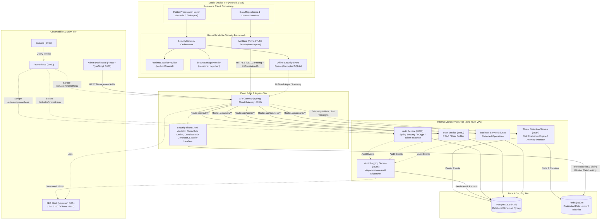

# Cloud Native Runtime Protection and API Security Framework: Architecture Specification

## 1. Executive Summary & Final Architecture

The **Cloud Native Runtime Protection and API Security Framework** is a modular, defense-in-depth security platform engineered to safeguard modern client-server mobile architectures against physical device compromise, dynamic binary instrumentation, automated API exploitation, unauthorized privilege escalation, and stealth lateral movement.

Unlike point solutions that treat mobile endpoint security and cloud infrastructure independently, this framework orchestrates client-side **Runtime Application Self-Protection (RASP)** with zero-trust **API Gateway enforcement**, an asynchronous **Threat Detection & Risk Evaluation Engine**, immutable **Audit Logging**, and centralized cloud-native observability.

### End-to-End System Topology



---

## 2. Port Mapping & Network Segmentation Matrix

The architecture employs strict network zoning: external clients communicate exclusively via the API Gateway on port `8080`, while internal services communicate over dedicated internal container bridge networks.

| Component / Service | Container Name | Host Port | Internal Port | Protocol | Access Scope |
| :--- | :--- | :--- | :--- | :--- | :--- |
| **API Gateway** | `api-gateway` | `8080` | `8080` | HTTP/HTTPS | Public / Mobile Client & Admin |
| **Auth Service** | `auth-service` | `8081` | `8081` | HTTP (REST) | Internal (via Gateway) |
| **User Service** | `user-service` | `8082` | `8082` | HTTP (REST) | Internal (via Gateway) |
| **Business Service** | `business-service` | `8083` | `8083` | HTTP (REST) | Internal (via Gateway) |
| **Threat Detection** | `threat-detection-service` | `8084` | `8084` | HTTP (REST) | Internal (via Gateway) |
| **Audit Logging** | `audit-logging-service` | `8085` | `8085` | HTTP (REST) | Internal (Asynchronous Event Ingestion) |
| **PostgreSQL** | `postgres` | `5432` | `5432` | TCP (PostgreSQL) | Internal Persistence Network |
| **Redis Cache** | `redis` | `6379` | `6379` | TCP (RESP) | Internal Cache & Rate Limit Network |
| **Elasticsearch** | `elasticsearch` | `9200` | `9200` | HTTP | Internal SIEM Network |
| **Logstash** | `logstash` | `5044` | `5044` | TCP / Beats | Internal Log Pipeline |
| **Kibana** | `kibana` | `5601` | `5601` | HTTP | SecOps Administrators |
| **Prometheus** | `prometheus` | `9090` | `9090` | HTTP | SecOps Observability |
| **Grafana** | `grafana` | `3000` | `3000` | HTTP | SecOps Dashboards |
| **Admin Dashboard** | `admin-dashboard` | `5173` | `80` (Nginx) | HTTP | Administrator Browser |

---

## 3. End-to-End Data Flow

### 3.1 Authentication & Session Initiation Flow
1. **Device Pre-Flight**: Client initiates `SecurityService.checkRuntimeSecurity()`. Native detectors execute memory and file system integrity audits.
2. **Payload Construction**: Mobile client generates an ephemeral request payload containing credentials and attaches `X-Correlation-ID: <UUID>` and device fingerprint headers.
3. **Gateway Ingestion**: The API Gateway intercepts the request at `/api/auth/login`:
   - Validates IP against Redis sliding-window rate limiters (default: 5 requests/min).
   - Injects canonical `X-Correlation-ID` if absent.
   - Enforces security response headers (`Content-Security-Policy`, `X-Content-Type-Options: nosniff`, `Strict-Transport-Security`).
4. **Credential Verification**: Request routed to `auth-service`:
   - BCrypt/Argon2 matches hashed password against PostgreSQL `users` table.
   - Generates dual cryptographically signed JWT tokens: Access Token (short-lived, 15m) and Refresh Token (long-lived, 7d, stored hashed in `refresh_tokens`).
5. **Audit Dispatch**: `auth-service` asynchronously fires a structured `AUTH_SUCCESS` event to `audit-logging-service`.
6. **Encrypted Client Storage**: Mobile client extracts tokens and securely commits them to OS-level hardware keystores via `SecureStorageProvider` (`EncryptedSharedPreferences` backed by Android Keystore, or iOS Keychain with `kSecAttrAccessibleAfterFirstUnlockThisDeviceOnly`).

### 3.2 Runtime Threat Incident & Mitigation Flow
```
[Mobile App / RASP] 
      │ (Detects Frida / ptrace attach)
      ▼
[SecurityStatus Evaluated] ──> Status: CRITICAL (detectedThreats: ["FRIDA_DETECTED"])
      │
      ├──> [Local Policy Enforcement]: Lock sensitive UI, flush cached in-memory credentials
      │
      └──> [API Event Ingestion]: POST /api/security/events
                 │
                 ▼
          [API Gateway] ──> Injects X-Correlation-ID, logs source IP
                 │
                 ▼
   [Threat Detection Service]
                 │
                 ├──> [RiskEvaluationService]: Recalculates risk score independently
                 ├──> [Redis Counter]: Increments threat occurrences for (deviceId, userId)
                 ├──> [PostgreSQL]: Inserts immutable row into security_events
                 │
                 ▼
   [Server-Side Response Policy]
                 │ (Risk Score >= CRITICAL)
                 ├──> [Redis Blacklist]: Immediately revokes active user sessions
                 └──> [Audit Logging]: Emits high-priority SECURITY_ALERT to ELK
```

---

## 4. Microservices Decomposition & Boundaries

Each backend service is built as a self-contained Spring Boot 3.x microservice adhering to Domain-Driven Design (DDD) principles:

1. **`api-gateway`**:
   - Single point of ingress.
   - Non-blocking reactive runtime (Spring Cloud Gateway / Project Reactor).
   - Enforces edge authentication (stateless JWT decoding and signature verification).
   - Distributed rate limiting via Redis Lua scripts.
2. **`auth-service`**:
   - Manages user identity, registration, credential rotation, and session lifecycle.
   - Issues HMAC-SHA256 signed JWTs with structured claims (user ID, roles, issuer, jti).
   - Handles token refresh rotation and blacklisting.
3. **`user-service`**:
   - Domain entity management for user profiles, RBAC assignments, and administrative user audits.
4. **`business-service`**:
   - Domain-specific reference microservice providing transactional endpoints to demonstrate secure context propagation and authorization enforcement.
5. **`threat-detection-service`**:
   - Ingestion hub for client and gateway security telemetry.
   - Houses the deterministic `RiskEvaluationService` and stateful anomaly detector.
6. **`audit-logging-service`**:
   - Centralized compliance logger persisting all security-sensitive operations with correlation IDs.

---

## 5. Security Architecture & Zero-Trust Posture

The architecture enforces Zero Trust across all layers:
- **Never Trust the Client**: Client-supplied risk ratings are treated as untrusted hints. The backend `RiskEvaluationEngine` re-evaluates all telemetry against server-side heuristics and historical threat records.
- **Mutual Isolation**: Microservices do not expose raw database tables across boundaries; communications adhere to strict REST DTO contracts.
- **Defence in Depth**: Even if an attacker defeats client-side SSL pinning via memory patching, they are immediately bounded by gateway rate limits, JWT signatures, strict RBAC authorization, and automated anomaly flags.
