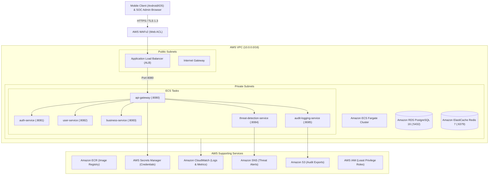

# AppShieldX - AWS Cloud Demonstration & Deployment Guide

## 1. Cloud Architecture Overview

AppShieldX is designed for cloud-native deployment on Amazon Web Services (AWS) using modern containerized microservices and managed platform primitives.



---

## 2. Deployment Profiles & Cost Matrix

To balance production realism with budget safety, AppShieldX provides two distinct deployment profiles:

| Capability / Resource | Demo Lite Profile (Recommended for Demo) | Full Cloud Demo Profile |
| :--- | :--- | :--- |
| **VPC & Subnets** | 2 Public Subnets + 2 Private Subnets | 2 Public + 2 Private (Multi-AZ) |
| **Ingress Load Balancer**| AWS Application Load Balancer (ALB) | AWS ALB + AWS WAFv2 Web ACL |
| **Compute Engine** | Amazon ECS on AWS Fargate (0.5 vCPU, 1 GB RAM) | Multi-task ECS Fargate Services |
| **PostgreSQL Database** | Single-AZ Amazon RDS `db.t4g.micro` | Multi-AZ Amazon RDS `db.t4g.small` |
| **Redis Cache** | Lightweight Container / Instance | Managed Amazon ElastiCache Redis `cache.t4g.micro` |
| **Secrets & Keys** | AWS Secrets Manager (1 Secret) | AWS Secrets Manager with KMS CMEK |
| **Observability** | CloudWatch Log Group (7-day retention) | CloudWatch Container Insights & Alarms |
| **Alert Notifications** | Amazon SNS Topic (Email subscription) | Amazon SNS + SQS Dead-Letter Queues |
| **Compliance Storage** | Amazon S3 (Encrypted, Private) | Amazon S3 with Lifecycle & Object Lock |
| **Estimated Cost** | **~$1.20 - $1.50 per 24h run** | **~$4.50 - $6.50 per 24h run** |

---

## 3. Step-by-Step Deployment Instructions

### Prerequisites
1. Installed **AWS CLI v2** (`aws --version`).
2. Installed **Terraform v1.5+** (`terraform version`).
3. Installed **Docker** (`docker --version`).
4. Configured AWS Credentials with permissions for VPC, IAM, ECR, ECS, RDS, SecretsManager, and CloudWatch.

### Step 1: Authenticate to AWS
Verify that your AWS session is active:
```powershell
aws sts get-caller-identity
```

### Step 2: Initialize and Deploy with Terraform
Navigate to the Terraform configuration directory:
```powershell
cd infrastructure\terraform
```

Review variables in `terraform.tfvars.example` and create your configuration:
```powershell
cp terraform.tfvars.example terraform.tfvars
```

Initialize provider plugins:
```powershell
terraform init
```

Run execution plan:
```powershell
terraform plan -var="deployment_profile=demo_lite" -var="aws_region=ap-south-1"
```

Apply infrastructure provisioning:
```powershell
terraform apply -var="deployment_profile=demo_lite" -var="aws_region=ap-south-1" -auto-approve
```

### Step 3: Capture Deployment Outputs
Retrieve the public endpoint:
```powershell
$albUrl = terraform output -raw alb_dns_name
Write-Host "Deployed Gateway URL: http://$albUrl"
```

### Step 4: Verify Live Endpoints
Run the automated verification script:
```powershell
python ..\aws\verify_aws_deployment.py --endpoint "http://$albUrl" --region "ap-south-1"
```

Verify the health check directly:
```powershell
curl "http://$albUrl/actuator/health"
```

---

## 4. Teardown & Safe Resource Deletion

To ensure zero ongoing charges after testing or reviewing the project, immediately destroy all resources:

```powershell
cd infrastructure\terraform
terraform destroy -auto-approve
```

Or execute the provided automated teardown script:
```powershell
powershell -ExecutionPolicy Bypass -File .\infrastructure\aws\cleanup_aws.ps1 -AutoApprove
```
