# Database Architecture & Schema Specification

## 1. Design Principles & Data Integrity

The persistence tier relies on **PostgreSQL 15+** managed strictly through **Flyway versioned migration scripts**. Hibernate automatic DDL updates (`ddl-auto: update`) are strictly forbidden in all runtime environments to prevent schema drift and preserve deterministic database state.

Key architecture tenets:
1. **Strong Referential Integrity**: Explicit foreign keys with cascading rules that protect audit log integrity (`ON DELETE RESTRICT` for security trails).
2. **Deterministic Indexing**: Indexes specifically targeted for fast threat correlation, log aggregation, and user lookup.
3. **Partition-Ready Auditing**: `audit_logs` and `security_events` schemas designed to support range partitioning by timestamp in high-throughput enterprise configurations.

---

## 2. Entity Relationship Diagram (ERD)

```mermaid
erDiagram
    USERS ||--o{ USER_ROLES : "assigned"
    ROLES ||--o{ USER_ROLES : "contains"
    USERS ||--o{ REFRESH_TOKENS : "owns"
    USERS ||--o{ SECURITY_EVENTS : "triggers"
    USERS ||--o{ AUDIT_LOGS : "acts_in"
    USERS ||--o{ BUSINESS_DATA : "creates"

    USERS {
        uuid id PK
        varchar username UK
        varchar email UK
        varchar password_hash
        boolean enabled
        boolean account_locked
        timestamp created_at
        timestamp updated_at
    }

    ROLES {
        bigint id PK
        varchar name UK
        varchar description
    }

    USER_ROLES {
        uuid user_id PK,FK
        bigint role_id PK,FK
    }

    REFRESH_TOKENS {
        uuid id PK
        uuid user_id FK
        varchar token_hash UK
        timestamp expiry_date
        boolean revoked
        timestamp created_at
    }

    SECURITY_EVENTS {
        uuid id PK
        uuid user_id FK
        varchar device_id
        varchar event_type
        varchar severity
        varchar source
        text description
        varchar ip_address
        varchar correlation_id
        jsonb metadata
        timestamp created_at
    }

    AUDIT_LOGS {
        uuid id PK
        uuid user_id FK
        varchar service
        varchar endpoint
        varchar http_method
        integer http_status
        varchar ip_address
        varchar correlation_id
        varchar event_type
        varchar severity
        text message
        timestamp created_at
    }

    BUSINESS_DATA {
        uuid id PK
        uuid user_id FK
        varchar title
        text content
        varchar sensitivity_level
        timestamp created_at
        timestamp updated_at
    }
```



---

## 3. Detailed Table Definitions & SQL DDL

### 3.1 Migration `V1__init_schema.sql` Outline

```sql
-- Enable UUID extension
CREATE EXTENSION IF NOT EXISTS "uuid-ossp";

-- Table: roles
CREATE TABLE roles (
    id BIGSERIAL PRIMARY KEY,
    name VARCHAR(50) NOT NULL UNIQUE,
    description VARCHAR(255)
);

-- Seed fundamental roles
INSERT INTO roles (name, description) VALUES 
('ROLE_USER', 'Standard mobile application user'),
('ROLE_ADMIN', 'Security operations administrator');

-- Table: users
CREATE TABLE users (
    id UUID PRIMARY KEY DEFAULT uuid_generate_v4(),
    username VARCHAR(100) NOT NULL UNIQUE,
    email VARCHAR(150) NOT NULL UNIQUE,
    password_hash VARCHAR(255) NOT NULL,
    enabled BOOLEAN NOT NULL DEFAULT TRUE,
    account_locked BOOLEAN NOT NULL DEFAULT FALSE,
    created_at TIMESTAMP WITH TIME ZONE NOT NULL DEFAULT CURRENT_TIMESTAMP,
    updated_at TIMESTAMP WITH TIME ZONE NOT NULL DEFAULT CURRENT_TIMESTAMP
);

-- Table: user_roles
CREATE TABLE user_roles (
    user_id UUID NOT NULL REFERENCES users(id) ON DELETE CASCADE,
    role_id BIGINT NOT NULL REFERENCES roles(id) ON DELETE CASCADE,
    PRIMARY KEY (user_id, role_id)
);

-- Table: refresh_tokens
CREATE TABLE refresh_tokens (
    id UUID PRIMARY KEY DEFAULT uuid_generate_v4(),
    user_id UUID NOT NULL REFERENCES users(id) ON DELETE CASCADE,
    token_hash VARCHAR(64) NOT NULL UNIQUE,
    expiry_date TIMESTAMP WITH TIME ZONE NOT NULL,
    revoked BOOLEAN NOT NULL DEFAULT FALSE,
    created_at TIMESTAMP WITH TIME ZONE NOT NULL DEFAULT CURRENT_TIMESTAMP
);

-- Table: security_events
CREATE TABLE security_events (
    id UUID PRIMARY KEY DEFAULT uuid_generate_v4(),
    user_id UUID REFERENCES users(id) ON DELETE SET NULL,
    device_id VARCHAR(128) NOT NULL,
    event_type VARCHAR(64) NOT NULL,
    severity VARCHAR(32) NOT NULL,
    source VARCHAR(64) NOT NULL,
    description TEXT,
    ip_address VARCHAR(45) NOT NULL,
    correlation_id VARCHAR(64) NOT NULL,
    metadata JSONB,
    created_at TIMESTAMP WITH TIME ZONE NOT NULL DEFAULT CURRENT_TIMESTAMP
);

-- Table: audit_logs
CREATE TABLE audit_logs (
    id UUID PRIMARY KEY DEFAULT uuid_generate_v4(),
    user_id UUID REFERENCES users(id) ON DELETE SET NULL,
    service VARCHAR(64) NOT NULL,
    endpoint VARCHAR(255) NOT NULL,
    http_method VARCHAR(10) NOT NULL,
    http_status INTEGER NOT NULL,
    ip_address VARCHAR(45) NOT NULL,
    correlation_id VARCHAR(64) NOT NULL,
    event_type VARCHAR(64) NOT NULL,
    severity VARCHAR(32) NOT NULL,
    message TEXT NOT NULL,
    created_at TIMESTAMP WITH TIME ZONE NOT NULL DEFAULT CURRENT_TIMESTAMP
);

-- Table: business_data (Reference domain resource)
CREATE TABLE business_data (
    id UUID PRIMARY KEY DEFAULT uuid_generate_v4(),
    user_id UUID NOT NULL REFERENCES users(id) ON DELETE CASCADE,
    title VARCHAR(200) NOT NULL,
    content TEXT NOT NULL,
    sensitivity_level VARCHAR(32) NOT NULL DEFAULT 'CONFIDENTIAL',
    created_at TIMESTAMP WITH TIME ZONE NOT NULL DEFAULT CURRENT_TIMESTAMP,
    updated_at TIMESTAMP WITH TIME ZONE NOT NULL DEFAULT CURRENT_TIMESTAMP
);
```

---

## 4. Performance Indexing Matrix

To ensure sub-millisecond query responses under high request volumes, the following B-tree and GIN indexes are established:

```sql
-- Users Indexes
CREATE INDEX idx_users_email ON users(email);
CREATE INDEX idx_users_username ON users(username);

-- Refresh Token Index
CREATE INDEX idx_refresh_tokens_hash ON refresh_tokens(token_hash);
CREATE INDEX idx_refresh_tokens_user ON refresh_tokens(user_id);

-- Security Events Indexes
CREATE INDEX idx_security_events_user ON security_events(user_id);
CREATE INDEX idx_security_events_device ON security_events(device_id);
CREATE INDEX idx_security_events_type ON security_events(event_type);
CREATE INDEX idx_security_events_severity ON security_events(severity);
CREATE INDEX idx_security_events_timestamp ON security_events(created_at DESC);
CREATE INDEX idx_security_events_correlation ON security_events(correlation_id);

-- Audit Logs Indexes
CREATE INDEX idx_audit_logs_timestamp ON audit_logs(created_at DESC);
CREATE INDEX idx_audit_logs_correlation ON audit_logs(correlation_id);
CREATE INDEX idx_audit_logs_user ON audit_logs(user_id);
CREATE INDEX idx_audit_logs_service ON audit_logs(service);
CREATE INDEX idx_audit_logs_event_type ON audit_logs(event_type);

-- Business Data Indexes
CREATE INDEX idx_business_data_user ON business_data(user_id);
```
