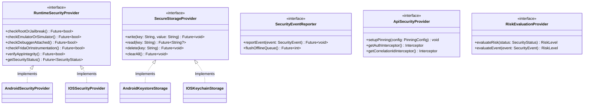

# Security Framework Design Specification & Reusability Model

## 1. Architectural Philosophy: The Framework vs. Reference App

The central contribution of this project is the **Reusable Security Framework**, not merely an isolated mobile application. 

In traditional enterprise projects, security mechanisms (such as root checks, token storage, and pinning) are frequently hardcoded directly into presentation controllers, rendering them fragile, unmaintainable, and impossible to reuse across organizational micro-apps.

This framework decouples security engineering from application business logic by providing:
1. **Standardized Security Abstractions**: Abstract provider interfaces for runtime protection, storage, and networking.
2. **Platform-Agnostic Core**: A unified Flutter/Dart domain layer communicating with native platforms via clean `MethodChannel` bridges.
3. **Pluggable Backend Modules**: Independent microservices for threat ingestion, risk scoring, and audit logging that can service any client application adhering to the contract.

The included application, **`SecureApp`**, serves strictly as the *reference consumer* that exercises, validates, and demonstrates these capabilities.

---

## 2. Framework Provider Abstractions

The framework exposes seven primary provider interfaces in the client and backend layers:



### 2.1 Core Interfaces Overview

1. **`RuntimeSecurityProvider`**:
   - Platform-agnostic contract for querying environmental integrity, debuggers, hooks, and emulators.
   - Realized through `AndroidSecurityService` (Kotlin) and `IOSSecurityService` (Swift).

2. **`SecureStorageProvider`**:
   - Hardware-backed key-value encryption interface.
   - Maps to Android Keystore (`MasterKey` + AES-256-GCM) on Android and Keychain Services (`kSecClassGenericPassword` with biometric access control flags) on iOS.

3. **`SecurityEventReporter`**:
   - Manages asynchronous event dispatching to the cloud gateway.
   - Backed by an encrypted local SQLite queue for resilient offline telemetry persistence.

4. **`ApiSecurityProvider`**:
   - Network pipeline security interface configuring TLS 1.3 certificate/public-key pinning, automatic `X-Correlation-ID` header injection, and token refresh interceptors.

5. **`RiskEvaluationProvider`**:
   - Dual-sided risk calculation engine evaluating deterministic security signals against threshold matrices.

---

## 3. Data Models: SecurityStatus & SecurityConfig

### 3.1 SecurityStatus Model

The canonical model produced by `RuntimeSecurityProvider.getSecurityStatus()`:

```json
{
  "rootDetected": false,
  "jailbreakDetected": false,
  "emulatorDetected": false,
  "simulatorDetected": false,
  "debuggerDetected": false,
  "fridaDetected": false,
  "integrityValid": true,
  "sslPinningEnabled": true,
  "secureStorageAvailable": true,
  "riskLevel": "LOW",
  "detectedThreats": [],
  "timestamp": "2026-09-18T18:30:00.000Z",
  "deviceId": "c4b9f2d1-8a9e-4b2a-8f91-23f0a9b81e4c",
  "platform": "android"
}
```

### 3.2 SecurityConfig Model

The configuration blueprint allowing applications to configure framework policies dynamically:

```dart
class SecurityConfig {
  final bool runtimeProtectionEnabled;
  final bool rootDetectionEnabled;
  final bool jailbreakDetectionEnabled;
  final bool debuggerDetectionEnabled;
  final bool fridaDetectionEnabled;
  final bool integrityCheckEnabled;
  final bool certificatePinningEnabled;
  final bool biometricEnabled;
  final bool securityEventReportingEnabled;
  final String riskThreshold; // "LOW", "MEDIUM", "HIGH", "CRITICAL"
  final int sessionTimeoutSeconds;
  final List<String> pinnedCertificatesSHA256;

  const SecurityConfig({
    this.runtimeProtectionEnabled = true,
    this.rootDetectionEnabled = true,
    this.jailbreakDetectionEnabled = true,
    this.debuggerDetectionEnabled = true,
    this.fridaDetectionEnabled = true,
    this.integrityCheckEnabled = true,
    this.certificatePinningEnabled = true,
    this.biometricEnabled = true,
    this.securityEventReportingEnabled = true,
    this.riskThreshold = "MEDIUM",
    this.sessionTimeoutSeconds = 900,
    this.pinnedCertificatesSHA256 = const [],
  });
}
```

---

## 4. MethodChannel Native Bridge Design

The Flutter core interacts with Android and iOS native security primitives using a dedicated channel:

- **Channel Name**: `com.framework.security/runtime_protection`

### Method Invocation Table

| Method Name | Arguments | Native Android Handler | Native iOS Handler | Return Type |
| :--- | :--- | :--- | :--- | :--- |
| `checkRootOrJailbreak` | None | `RootDetector.isRooted()` | `JailbreakDetector.isJailbroken()` | `Boolean` |
| `checkEmulatorOrSimulator` | None | `EmulatorDetector.isEmulator()` | `SimulatorDetector.isSimulator()` | `Boolean` |
| `checkDebuggerAttached` | None | `DebuggerDetector.isDebuggerAttached()` | `DebuggerDetector.isDebuggerAttached()` | `Boolean` |
| `checkFrida` | None | `FridaDetector.isFridaPresent()` | `FridaDetector.isFridaPresent()` | `Boolean` |
| `verifyIntegrity` | `expectedSignature` | `IntegrityChecker.verifySignature()` | `IntegrityChecker.verifyBundle()` | `Boolean` |
| `getComprehensiveStatus` | `configMap` | Aggregates all detectors | Aggregates all detectors | `Map<String, Object>` |

---

## 5. Third-Party Integration Model

To demonstrate reusability, any third-party Flutter application can integrate the security framework in four concise steps:

```dart
// Step 1: Initialize the Security Framework in main.dart
void main() async {
  WidgetsFlutterBinding.ensureInitialized();

  final securityConfig = SecurityConfig(
    runtimeProtectionEnabled: true,
    rootDetectionEnabled: true,
    certificatePinningEnabled: true,
    riskThreshold: "MEDIUM",
    pinnedCertificatesSHA256: [
      "sha256/AAAAAAAAAAAAAAAAAAAAAAAAAAAAAAAAAAAAAAAAAAA=",
    ],
  );

  final framework = await SecurityFramework.initialize(config: securityConfig);

  // Step 2: Perform Pre-Flight Runtime Verification
  final status = await framework.checkRuntimeSecurity();
  if (status.riskLevel == RiskLevel.critical) {
    // Gracefully handle high-risk device: terminate session or display advisory
    runApp(SecurityViolationApp(threats: status.detectedThreats));
    return;
  }

  // Step 3: Use Secure Storage Provider for Session State
  await framework.secureStorage.write("user_session_token", "jwt_token_sample");

  // Step 4: Execute API Calls via Framework Pinned Client
  final apiClient = framework.createSecureApiClient(
    baseUrl: "https://api.enterprise.domain:8080",
  );
  
  runApp(EnterpriseBusinessApp(apiClient: apiClient));
}
```

This clean architecture ensures that business teams never interact with low-level JNI, Objective-C/Swift runtimes, or complex crypto routines directly.
