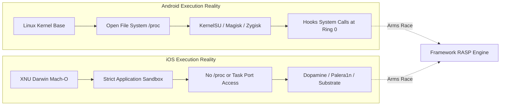

# Security Framework Constraints, Platform Limitations & Threat Realities

## 1. Academic & Engineering Transparency

In computer security and offensive computing research, it is widely recognized that **client-side controls operate in an untrusted execution environment**. When an attacker has physical possession of a mobile device, arbitrary code execution, kernel modification, and memory tampering capabilities exist.

This document formally records the technical limitations of this framework, preserving academic rigor and practical engineering honesty.

---

## 2. Mobile Platform Constraints: Android vs. iOS

### 2.1 Android RASP Limitations & Kernel-Level Hiding
- **Zygisk & KernelSU**: Modern root frameworks like KernelSU and APatch operate directly inside kernel space (`Ring 0`) rather than user space (`Ring 3`). When an attacker configures Mount Namespace Separation and kernel-level path spoofing, user-space probes reading `/proc/mounts` or checking file existence for `/system/bin/su` can be deceived.
- **Dynamic Binary Instrumentation (Frida)**: Attackers can rename the Frida listening binary, rebind to a non-standard TCP port (e.g., random high ports), and modify the internal `frida-agent.so` string table. While our framework checks open socket descriptors and native maps, determined reverse engineers utilizing inline hooking and anti-anti-debugging scripts can selectively bypass detection without hardware attestation.
- **Hardware-Backed Keystore**: On older or budget Android hardware lacking a dedicated Hardware Security Module (HSM) or StrongBox chip, the Android Keystore operates within ARM TrustZone (TEE) or software fallback. Software fallback keys can theoretically be extracted if a full TrustZone kernel exploit is chained.

### 2.2 iOS Sandboxing & Private API Restrictions
- **Zero Inter-Process Memory Inspection**: Apple App Store guidelines strictly forbid the use of private Mach kernel APIs (e.g., `task_for_pid()`). Consequently, an un-jailbroken or semi-jailbroken iOS app cannot directly inspect memory spaces of adjacent processes.
- **Debugger Detection (`ptrace` / `sysctl`)**: Calling `ptrace(PT_DENY_ATTACH, 0, 0, 0)` is a strong defense against interactive LLDB attachments, but it can be neutralized if an attacker hooks the `ptrace` system call symbol during Mach-O dyld loading via Frida or MobileSubstrate.
- **App Attest & DeviceCheck**: Full enterprise-grade App Attest requires active developer portal credentials and continuous validation through Apple's attestation servers. Our reference implementation demonstrates the local cryptographic challenge-response abstraction.

---

## 3. Network & Gateway Considerations

- **Certificate Pinning Maintenance**: Public key pinning (SPKI) provides robust protection against rogue or corporate MITM proxies (e.g., Charles, Burp Suite). However, hardcoded pin expiration or domain certificate turnover requires an orchestrated mobile app update cycle. The framework mitigates this via backup pin sets and remote security configuration refresh.
- **Latency Overheads**: Synchronous risk recalculation on every HTTP request introduces latency. To resolve this, our framework employs an **asynchronous telemetry ingestion pattern**: the gateway validates lightweight JWT tokens in microseconds, while complex behavioral anomaly scoring occurs asynchronously in Redis and the Threat Detection Service.

---

## 4. Defense-in-Depth Summary

Because client-side defenses cannot be considered 100% impenetrable against nation-state or kernel-level attackers, the framework's primary contribution is **Defense-in-Depth**:
1. Client RASP raises the cost and complexity of attacks dramatically, filtering out script kiddies, automated fuzzers, and standard modded APKs.
2. The server-side API Gateway and Threat Engine provide authoritative validation that no client tampering can disable.
