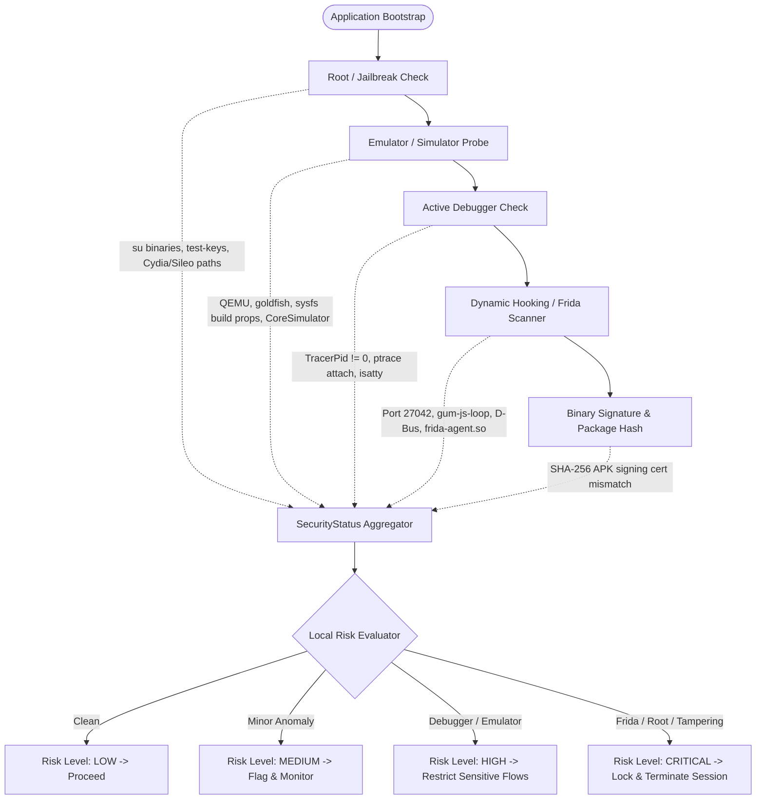

# Security Model & Threat Assessment Specification

## 1. STRIDE Threat Modeling Analysis

The framework's defenses are structured systematically against the Microsoft STRIDE threat classification model:

| Threat Category | Primary Attack Vector | Target Surface | Framework Countermeasure & Enforcement Layer |
| :--- | :--- | :--- | :--- |
| **Spoofing** | Device identity spoofing, credential stuffing, forged JWTs | Mobile Client / API Gateway | • Hardware-backed device ID hashing • HMAC-SHA256 signed JWTs with cryptographic signature validation at Gateway • Redis sliding-window brute-force rate limiter |
| **Tampering** | Binary patching, hook injection (Frida/Xposed), in-transit payload tampering | Client Memory & Transport | • RASP native integrity verification (APK signature check & bundle validation) • Frida port & memory scanner • TLS 1.3 Certificate / Public Key Pinning with strict TLS validation |
| **Repudiation** | Denying an administrative action or high-value business transaction | Backend Microservices | • Asynchronous immutable audit logging via `audit-logging-service` • Correlation ID (`X-Correlation-ID`) tied to authenticated `userId`, timestamp, and client IP |
| **Information Disclosure** | Token extraction from device storage, MITM interception, debug memory dumping | Local Storage & Gateway | • Android Keystore (`EncryptedSharedPreferences`) / iOS Keychain (`kSecClassGenericPassword`) • Anti-debugger checks (`ptrace(PTRACE_TRACEME)`, `sysctl` `P_TRACED`) • Sanitized global error payloads |
| **Denial of Service** | Volumetric API flooding, resource exhaustion attacks | Edge Gateway & Microservices | • Distributed Redis rate limiting (token bucket / sliding window per IP & User ID) • Gateway maximum request payload limit (10MB default, 2MB on auth) |
| **Elevation of Privilege** | User modifying payload to access `/api/admin/**` endpoints | Spring Security / Gateway | • Strict Role-Based Access Control (RBAC) enforced at both Gateway and downstream services • Token claim validation checking `ROLES` array against protected routes |

---

## 2. RASP Detection Matrix (Mobile Endpoint)

The client-side Runtime Application Self-Protection (RASP) layer combines multiple heuristic and signature-based probes:

### Detection Mechanisms Detail

#### Android (Kotlin Native)
1. **Root Detection**:
   - Verification of `su` binary existence across standard paths (`/system/bin/su`, `/system/xbin/su`, `/sbin/su`, `/system/app/Superuser.apk`).
   - Detection of known rooting management packages (`com.topjohnwu.magisk`, `eu.chainfire.supersu`).
   - Inspection of `Build.TAGS` for `"test-keys"`.
   - Execution of a temporary process execution check (`Runtime.getRuntime().exec("su")`).
2. **Emulator Detection**:
   - Examination of hardware properties: `Build.FINGERPRINT.startsWith("generic")`, `Build.MODEL.contains("google_sdk")`, `Build.HARDWARE.contains("goldfish") || Build.HARDWARE.contains("ranchu")`.
   - QEMU pipe checks via file descriptors (`/dev/socket/qemud`, `/dev/qemu_pipe`).
3. **Debugger Detection**:
   - Real-time polling of `android.os.Debug.isDebuggerConnected()`.
   - Parsing `/proc/self/status` for `TracerPid != 0`.
4. **Frida / Hooking Detection**:
   - TCP port scanning on localhost for default Frida server listening port (`27042`).
   - Inspecting `/proc/self/maps` for mapped libraries containing `"frida"`, `"gadget"`, `"substrate"`, or `"xposed"`.
5. **Integrity Checking**:
   - Dynamic validation of signing certificate SHA-256 fingerprint against an embedded release hash.

#### iOS (Swift Native)
1. **Jailbreak Detection**:
   - File existence probes for Cydia, Sileo, and Substrate (`/Applications/Cydia.app`, `/Library/MobileSubstrate/MobileSubstrate.dylib`, `/bin/bash`, `/usr/sbin/sshd`).
   - Sandbox escape verification by attempting to write to private directory paths outside the container (`/private/jailbreak_test.txt`).
   - Dynamic fork check using `fork()` (prohibited in normal iOS application sandboxes).
2. **Simulator Detection**:
   - Preprocessor check `#if targetEnvironment(simulator)` coupled with runtime validation of `SIMULATOR_DEVICE_NAME` environment variables.
3. **Debugger Detection**:
   - Querying process flags via `sysctl` checking for `P_TRACED` flag in `kinfo_proc`.
   - Native call to `ptrace(PT_DENY_ATTACH, 0, 0, 0)`.
4. **Frida Detection**:
   - Memory inspection scanning for Frida export symbols and listening ports (`27042`).

---

## 3. Server-Side Threat Analysis & Risk Engine

The backend **Threat Detection Service** never relies solely on client-reported risk levels. It enforces independent, multi-factor risk scoring:

### 3.1 Threat Severity & Scoring Weights

| Threat Event Type | Base Weight | Category | Server Action |
| :--- | :--- | :--- | :--- |
| `ROOT_DETECTED` | 80 | Critical Environmental | Invalidate user session; blacklist token |
| `JAILBREAK_DETECTED` | 80 | Critical Environmental | Invalidate user session; blacklist token |
| `FRIDA_DETECTED` | 95 | Active Tampering | Immediate session kill; log high-priority security alert |
| `TAMPERING_DETECTED` | 90 | Binary Modification | Reject request; trigger SecOps alert |
| `DEBUGGER_DETECTED` | 65 | Reverse Engineering | Restrict sensitive transactional endpoints |
| `EMULATOR_DETECTED` | 35 | Environmental Anomaly | Require biometric step-up; flag session |
| `RATE_LIMIT_EXCEEDED` | 40 | Abuse / Automated Attack | Return HTTP 429; throttle IP via Redis |
| `AUTH_FAILURE` | 20 | Credential Guessing | Increment failed login counter in Redis |
| `INVALID_TOKEN` | 50 | Session Hijacking Attempt | Reject request; monitor IP |

### 3.2 Dynamic Risk Evaluation Algorithm

The backend calculates the dynamic Risk Score ($R$) for an incoming session over a sliding window ($T = 15 \text{ min}$):

$$R = \min\left(100, \sum_{i=1}^{n} W(E_i) \cdot \lambda^{(t_{curr} - t_i)} + C_{auth\_fail} \times 15 + C_{rate\_limit} \times 20\right)$$

Where:
- $W(E_i)$ is the base weight of event $E_i$.
- $\lambda$ is the exponential decay factor for time decay.
- $C_{auth\_fail}$ is the cumulative count of failed authentication attempts in the window.
- $C_{rate\_limit}$ is the number of rate limit breaches.

#### Risk Thresholds & Policy Actions
- **$0 \le R < 30$ (LOW)**: Allow normal application operations.
- **$30 \le R < 60$ (MEDIUM)**: Allow normal access, record security telemetry event for monitoring.
- **$60 \le R < 80$ (HIGH)**: Enforce step-up verification, disallow administrative or high-value business actions.
- **$80 \le R \le 100$ (CRITICAL)**: Terminate active tokens via Redis revocation list, block incoming requests from device fingerprint with HTTP 403 Forbidden.

---

## 4. Cryptographic Standards & Key Life Cycle

1. **In-Transit Security**:
   - Strict HTTPS with TLS 1.3 preferred (TLS 1.2 minimum).
   - Perfect Forward Secrecy (PFS) cipher suites (e.g., `TLS_AES_256_GCM_SHA384`, `ECDHE-RSA-AES256-GCM-SHA384`).
   - Certificate Pinning implemented using SHA-256 Subject Public Key Info (SPKI) hashes.
2. **At-Rest Security**:
   - Android: AES-256-GCM authenticated encryption keys generated via `AndroidKeyStore` provider with hardware backing (StrongBox or TEE where available).
   - iOS: Keychain Services utilizing 256-bit AES encryption managed by the Secure Enclave.
3. **Password Security**:
   - Password hashing utilizing BCrypt with a work factor of 12 (or Argon2id where supported).
   - Enforced password complexity: minimum 8 characters, containing uppercase, lowercase, numeric, and special characters.
4. **Token Security**:
   - Short-lived Access Tokens (15 minutes).
   - Signed with HMAC-SHA256 using a minimum 256-bit high-entropy secret.
   - Refresh Tokens stored as cryptographically hashed digests (`SHA-256`) in PostgreSQL to prevent database breach token replay.
