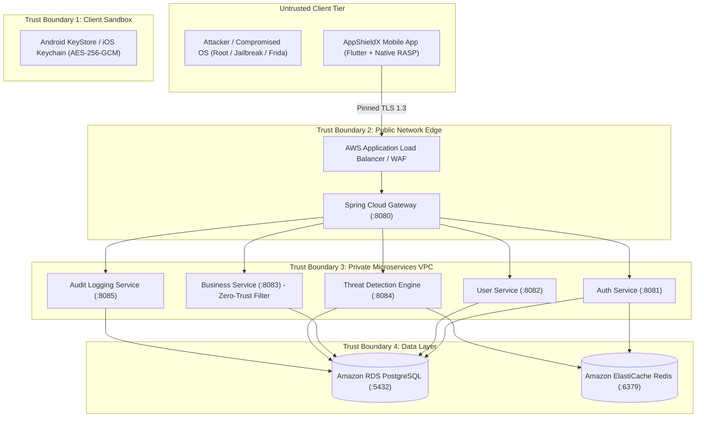

# AppShieldX - Comprehensive Threat Model & Security Architecture

## 1. Scope & Objective
This document details the threat model for **AppShieldX: A Cloud-Native Runtime Protection and API Security Framework for Client–Server Android and iOS Applications**.

The objective is to identify potential threat actors, attack surfaces, vulnerabilities, and mitigations across both client-side mobile execution environments and cloud-native backend services, using the **STRIDE** methodology (Spoofing, Tampering, Repudiation, Information Disclosure, Denial of Service, Elevation of Privilege).

---

## 2. System Architecture & Trust Boundaries

### Trust Boundary Definitions
1. **Trust Boundary 1 (Client Execution Sandbox)**:
   - Separates untrusted device environments (rooted Android, jailbroken iOS, malicious apps, Frida runtime) from the application process memory, hardware Keystore, and local SQLite event database.
2. **Trust Boundary 2 (Public Network Ingress)**:
   - Separates the mobile device and public internet from the cloud edge. Enforces pinned TLS 1.3, AWS ALB, and Spring Cloud Gateway filters.
3. **Trust Boundary 3 (API Gateway to Microservices VPC)**:
   - Separates edge proxy filters (rate limiter, JWT verifier) from internal microservices. Downstream microservices consume verified claims (`X-User-Id`, `X-User-Roles`, `X-Correlation-ID`) injected exclusively by the gateway.
4. **Trust Boundary 4 (Data Persistence Layer)**:
   - Separates compute microservices from durable PostgreSQL database storage and Redis state cache. Direct public internet access to ports 5432 and 6379 is strictly prevented by security groups.

---

## 3. STRIDE Threat Analysis Matrix

| STRIDE Category | Threat Description | Attack Vector / Scenario | Impact | AppShieldX Mitigation | Severity |
| :--- | :--- | :--- | :--- | :--- | :--- |
| **Spoofing** | Rogue Device or Fake Identity | Malicious client attempts to spoof another user's identity or falsify device telemetry. | Unauthorized account access, falsified risk status. | Cryptographic JWT signing (HS256/RS256), token expiration (15m), server-side identity injection (`X-User-Id`), device binding in PostgreSQL. Client events treated as unverified evidence until server verification. | **HIGH** |
| **Tampering** | Runtime Dynamic Hooking & Frida | Attacker attaches Frida agent (`27042`) or tampers with bytecode/DEX signatures to bypass checks. | Subversion of client security logic, API token extraction. | Native C/Kotlin/Swift RASP heuristics: TCP port probe, `/proc/self/maps` inspection, thread detection, signature checksums, Android Keystore protection. | **CRITICAL** |
| **Repudiation** | Denying Sensitive Transactions | Compromised client or rogue admin performs unauthorized operations and denies action. | Inability to audit security incidents, forensic gap. | Immutable append-only audit trail in `audit-logging-service`. Every request tagged with client IP, timestamp, user ID, and non-repudiable `X-Correlation-ID`. | **MEDIUM** |
| **Information Disclosure** | Data Leakage via MitM or Memory | Interception of API traffic via rogue CA certs or dumping tokens from application memory. | Credential compromise, token theft, PII breach. | Strict TLS 1.3 certificate/public-key pinning, `AndroidKeyStore` AES-256-GCM token encryption, HSTS headers, masking of sensitive fields in logs. | **CRITICAL** |
| **Denial of Service** | Credential Stuffing & API Flooding | Automated botnet floods `/api/v1/auth/login` or resource endpoints with high-volume requests. | Service degradation, database exhaustion, account lockout. | Distributed Redis sliding-window rate limiter via atomic Lua scripts (10 req/min for login, 100 req/min general, 50 req/min telemetry). AWS WAF rate-limiting rules. | **HIGH** |
| **Elevation of Privilege** | Insecure Direct Object Reference (IDOR) | Authenticated standard user attempts to access `/api/v1/resources/{id}` belonging to another user. | Horizontal privilege escalation, unauthorized record access. | Server-side resource ownership validation in `business-service`. Verification that authenticated `X-User-Id` owns the requested entity before returning record. | **HIGH** |
| **Elevation of Privilege** | Zero-Trust Bypass on Compromised Device | Rooted device with active debugger attempts to invoke high-value business transaction. | Exploitation of backend via tampered client runtime. | Dynamic Device Risk Scoring ($0-100$). `ZeroTrustSecurityFilter` in `business-service` rejects any request where device Risk Score $\ge 70$ with `HTTP 403 Forbidden`. | **CRITICAL** |

---

## 4. Security Assumptions & Realistic Limitations

1. **Client-Side RASP is Defense-in-Depth, Not Absolute**:
   - Detections (root, jailbreak, debugger, Frida) are best-effort heuristics. A skilled attacker with kernel-level patches or customized ROMs can eventually bypass client-side checks.
   - **Core Architecture Rule**: The server remains the ultimate authority. Business logic never trusts client claims of being "safe" without server-side validation and backend anomaly correlation.
2. **Network Confidentiality**:
   - All external communications require TLS. Plain HTTP is rejected or redirected at the edge load balancer.
3. **Least Privilege Infrastructure**:
   - Microservices operate in private subnets with strictly scoped IAM roles. PostgreSQL and Redis are never exposed to the public internet.
